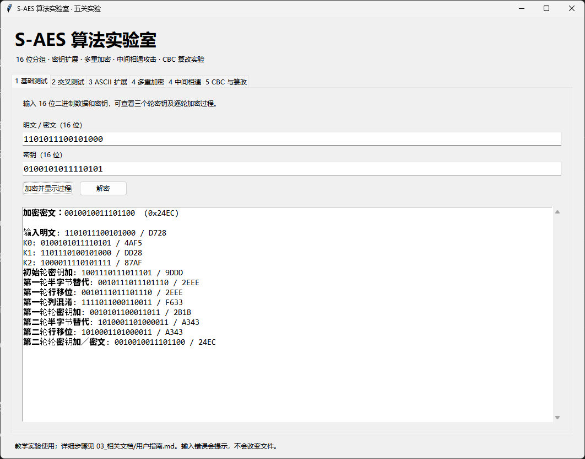
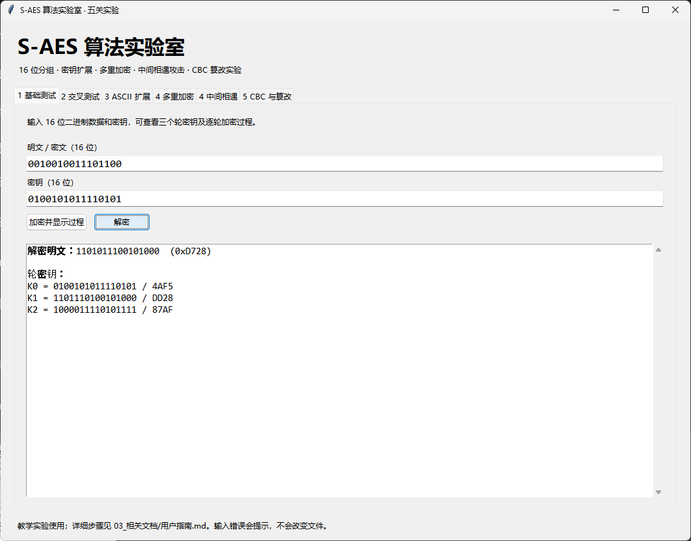

# 第一关实验记录：一个分组的加密与还原

**本次结果：通过。** 窗口接受 16 位明文与 16 位密钥，加密值符合公开向量，反向解密恢复原输入。

## 本次用例

| 参数 | 二进制 | HEX |
|---|---|---|
| 原明文 P | 1101011100101000 | D728 |
| 主密钥 K | 0100101011110101 | 4AF5 |
| 加密得到 C | 0010010011101100 | 24EC |
| 解密恢复 P | 1101011100101000 | D728 |

## 如何复现

打开“1 基础测试”，输入表中的 P、K，点击“加密并显示过程”。记录密文后，将该密文填回数据框，保持密钥不变，点击“解密”。通过条件是密文为 24EC，且反向得到 D728。

## 运算过程核对

| 步骤 | 状态 HEX |
|---|---|
| 轮密钥 K0 / K1 / K2 | 4AF5 / DD28 / 87AF |
| 初始轮密钥加 | 9DDD |
| 第一轮半字节替代 | 2EEE |
| 第一轮行移位 | 2EEE |
| 第一轮列混淆 | F633 |
| 第一轮轮密钥加 | 2B1B |
| 第二轮半字节替代 | A343 |
| 第二轮行移位 | A343 |
| 最后轮密钥加 | 24EC |

本例中两次行移位前后数值相同，是因为需要交换的两个半字节恰好相等，不代表没有执行该步骤。
公开向量给出独立预期值，解密往返则检查可逆性。自动测试还验证了固定密钥下全部 65536 个明文和 500 组随机明文/密钥，记录见 [原始日志](../test_log.txt)。

## 界面证据
### 图 1：加密输出与轮变换

### 图 2：恢复原始明文

