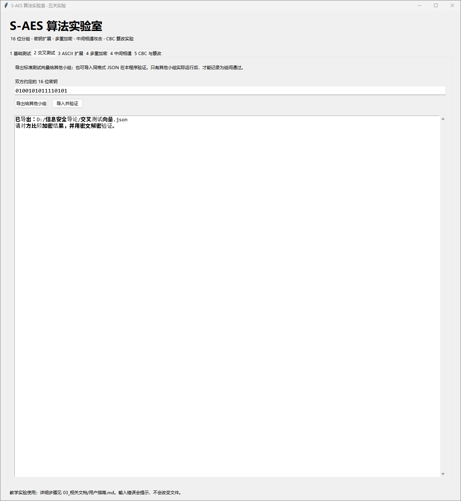
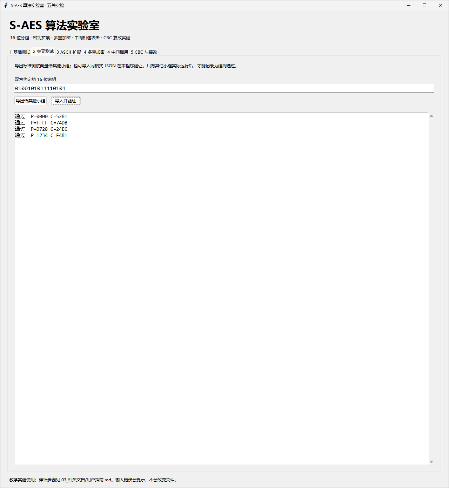

# 第二关实验记录：测试数据交换与实现互通

**已确认：导出和导入验证功能正常。真实组间验证待补充。** 当前截图来自本程序，没有对方独立实现的输出、成员或版本信息。

## 已完成的数据验证

约定密钥为 4AF5（0100101011110101）。导入后显示以下四项通过；导入处理会同时检查加密和解密关系。

| 明文 HEX | 文件中密文 HEX | 本程序验证 |
|---|---|---|
| 0000 | 52B1 | 通过 |
| FFFF | 74DB | 通过 |
| D728 | 24EC | 通过 |
| 1234 | F4B1 | 通过 |

## 交换文件和复核步骤

1. 在“2 交叉测试”页填写双方约定的密钥，点击“导出给其他小组”。
2. 将导出 JSON 交给对方，请其在自己的程序中分别计算加密和解密结果。
3. 对方提供其独立生成的向量或实际密文。本程序可导入同格式 JSON，或在基础页输入对方密文并解密。
4. 双方记录明文、密钥、密文、还原值、程序版本和时间，保存两边截图。
5. 填写 [组间交叉测试记录](../组间交叉测试记录.md)，再更新本关最终结论。

将自己导出的文件导回同一程序，可确认文件格式和数据处理一致，但不能替代其他小组的独立运行。
可交换文件见 [预置向量](../../01_源代码/examples/cross_vectors.json)。如有额外保存的实际导出文件，同目录保留备查。

## 当前截图
### 图 1：导出交换文件

### 图 2：四项数据在本机验证通过

