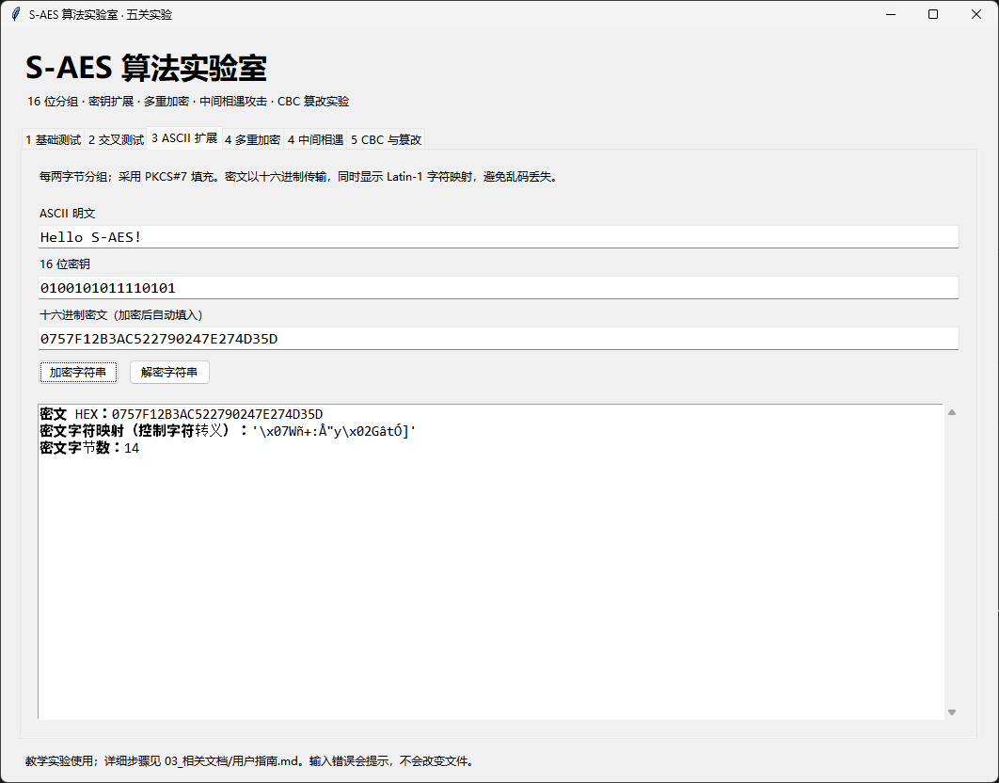
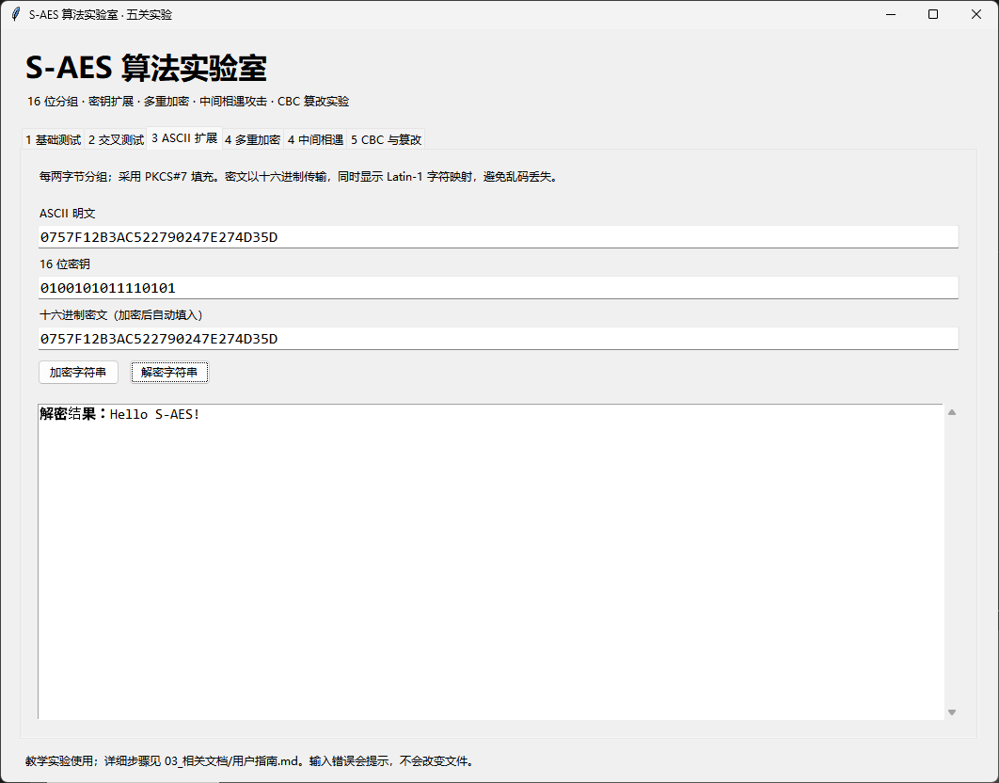

# 第三关实验记录：ASCII 消息的完整往返

**本次结果：通过。** 明文 Hello S-AES! 加密后可以从 HEX 密文恢复为相同字符串。

## 输入和输出

| 项目 | 本次值 |
|---|---|
| 明文 | `Hello S-AES!` |
| 密钥 HEX | 4AF5 |
| 密文 HEX | 0757F12B3AC522790247E274D35D |
| 密文字节数 | 14 |
| 解密文本 | `Hello S-AES!` |

## 操作与判定

在“3 ASCII 扩展”中输入明文和 16 位密钥，点击“加密字符串”。程序自动填入下方 HEX 密文框，再点击“解密字符串”，检查结果与原文完全一致。
解密按钮读取下方 HEX 框，上方明文框无需替换成密文。第二张截图中虽然上方也粘贴了密文，实际解密输入仍为下方 HEX 数据，因此不影响该次结果。

## 为什么输出是 14 字节

原文共 12 个 ASCII 字节。程序每两字节组成一个分组，采用 2 字节块大小的 PKCS#7 填充。偶数长度也要追加 02 02，以便可靠去除填充，所以加密输入为 14 字节、7 个分组。
密文字节可能无法直接显示为 ASCII；HEX 用于无损复制，Latin-1 映射与转义形式用于观察字节。

## 额外边界验证

自动测试覆盖空字符串、1/2/3 字符、空格和控制字符的往返；中文输入、奇数字节密文和无效填充应被拒绝。界面证据是本次 Hello S-AES! 用例，其他边界的断言见 [测试日志](../test_log.txt)。

## 界面证据
### 图 1：编码、密文与字节数

### 图 2：恢复 ASCII 文本

