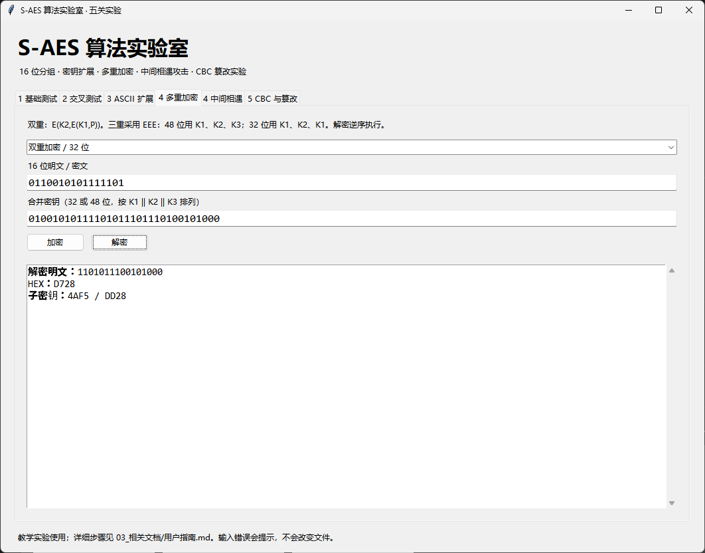
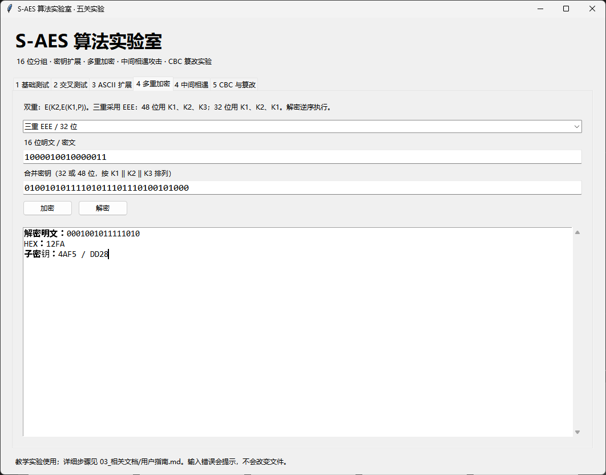
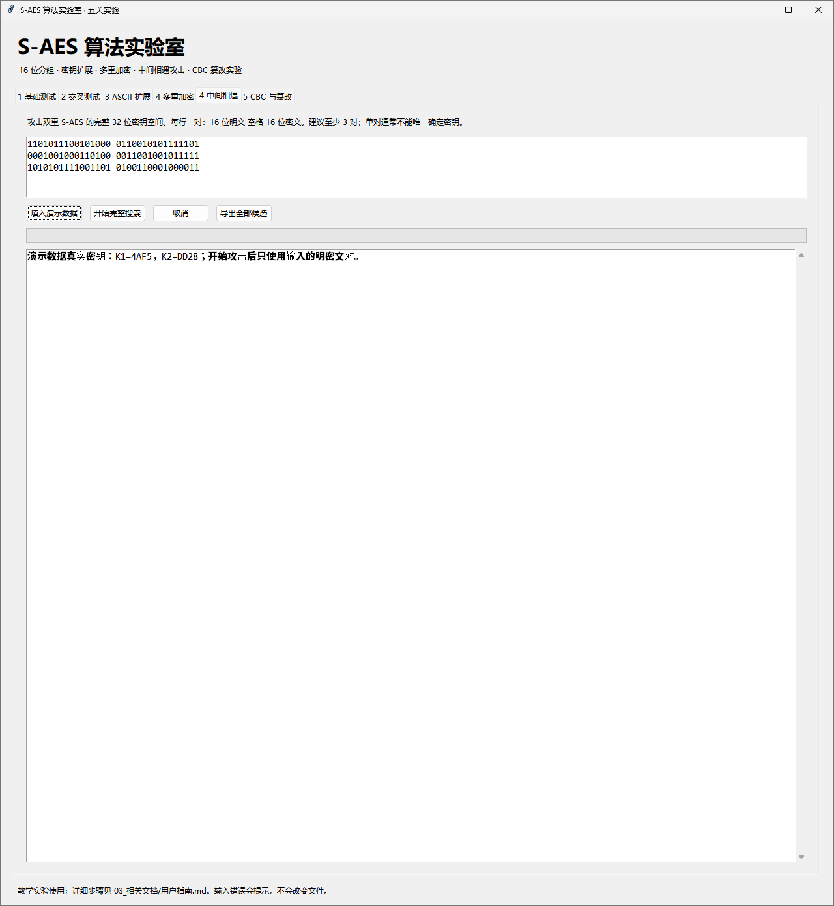
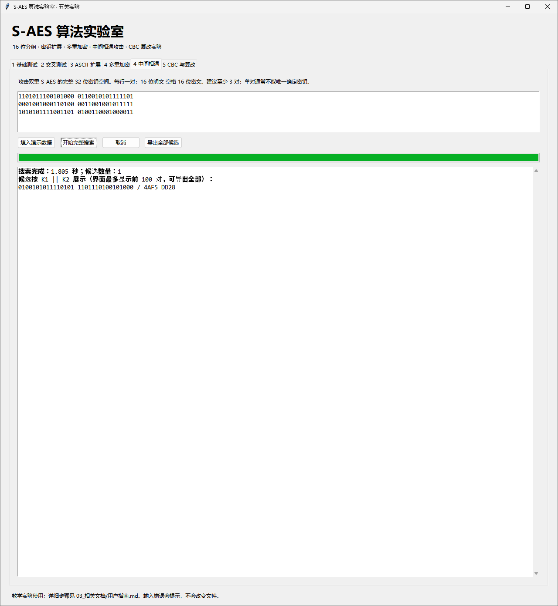

# 第四关实验记录：叠加加密与恢复双密钥

**本次结果：双重加密、32 位三重加密和中间相遇演示通过。** 软件还提供 48 位三重接口，当前截图没有展示该模式的运行，因此不将菜单截图记为 48 位测试通过。

## 两类加密的实际结果

两个子密钥固定为 K1=4AF5、K2=DD28，拼接顺序为 K1||K2，共 32 位。

| 模式 | 输入明文 HEX | 加密结果 HEX | 反向解密 HEX |
|---|---|---|---|
| 双重 EE | D728 | 657D | D728 |
| 三重 EEE，第三次复用 K1 | 12FA | 8483 | 12FA |

双重执行 K1→K2，解密逆序执行；32 位三重执行 K1→K2→K1。两个用例使用不同明文，均以解密恢复各自原文作为通过条件。
课程允许三重加密两种密钥长度方案任选其一，本次界面验证采用 32 位方案。自动测试另覆盖 48 位接口，见 [日志](../test_log.txt)。

## 中间相遇攻击记录

攻击输入为来自同一组双密钥的三对已知数据：

| 明文 HEX | 双重密文 HEX |
|---|---|
| D728 | 657D |
| 1234 | 325F |
| ABCD | 4C43 |

在“4 中间相遇”页点击“填入演示数据”，再点“开始完整搜索”。截图显示耗时 **1.805 秒**，候选数量为 **1**，恢复 `(K1,K2)=(4AF5,DD28)`，与生成数据使用的密钥一致。
截图耗时与自动测试摘要的耗时属于两次不同运行，分别保留，不互相替换。

## 搜索为何有效

由 C=E_K2(E_K1(P)) 可得 E_K1(P)=D_K2(C)。程序先建立全部 K1 的中间值表，再遍历 K2 查找匹配；每一边均枚举 65536 个子密钥，而非逐个尝试全部 2^32 个密钥对。
碰撞时保留所有 K1，随后使用其余明密文对过滤。单对通常会留下许多候选；本例三对筛选后只剩一对。生成示例时显示真实密钥用于人工核对，攻击函数的输入仅为明密文对。

## 界面证据
### 图 1：双重加密

### 图 2：双重解密

### 图 3：32 位 EEE 加密

### 图 4：32 位 EEE 解密

### 图 5：攻击输入与对照密钥

### 图 6：搜索结果与耗时

## 补充画面的用途

[模式菜单](补充记录/07_模式下拉菜单.png)只是展开下拉框；[重复解密画面](补充记录/08_重复的32位解密.png)与图 4 重复。两者均保留原图，但不据此增加测试结论。
