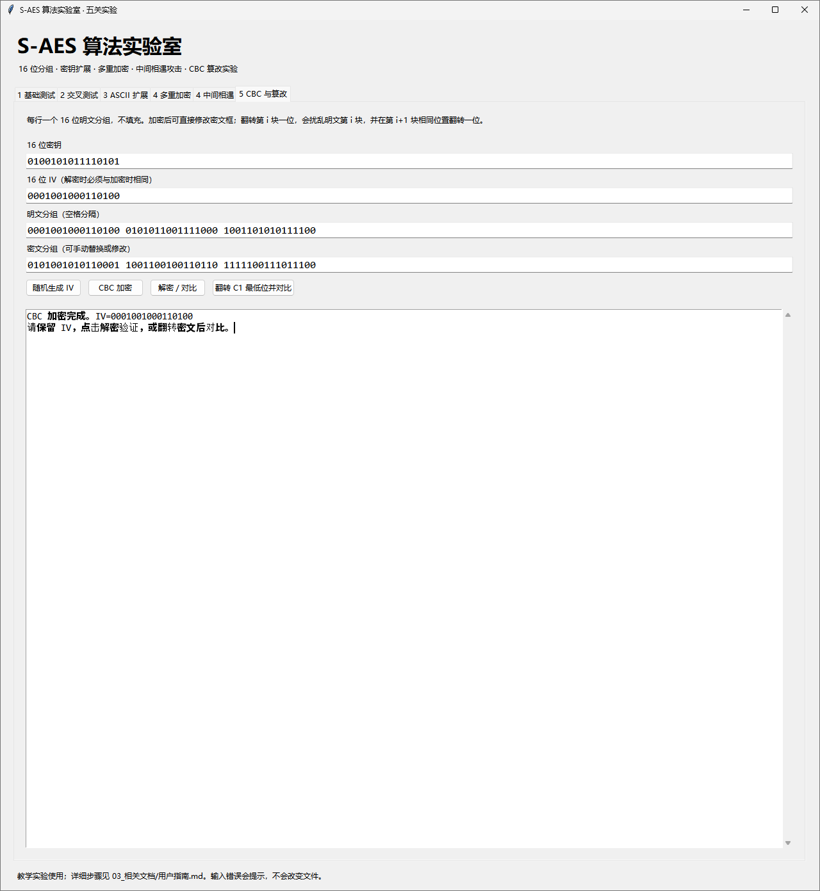
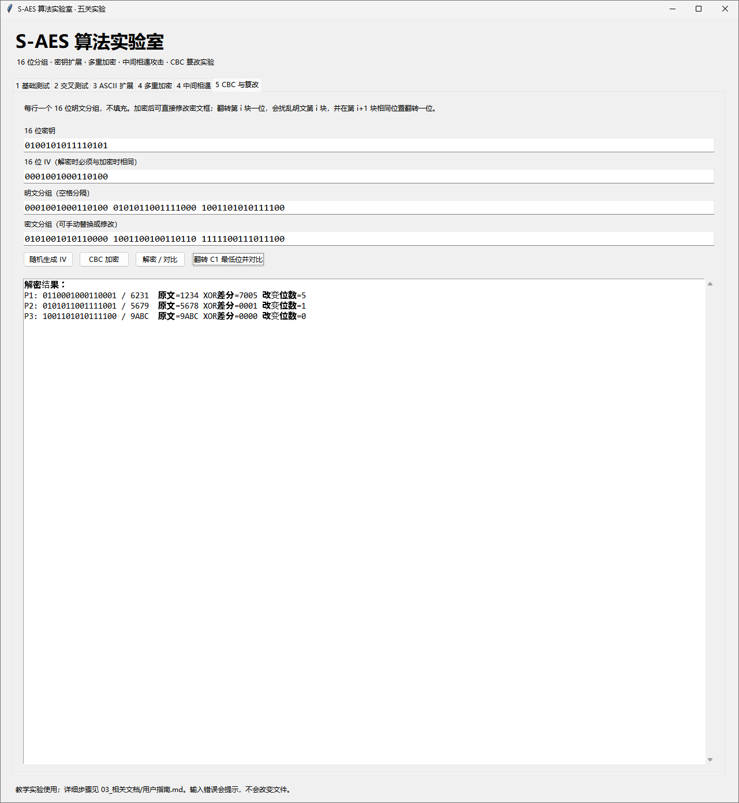

# 第五关实验记录：CBC 链接和密文错误传播

**本次结果：正常还原及篡改传播符合预期。** 本界面按完整 16 位分组输入，无文本编码或自动填充。

## 固定实验条件

- 密钥 K=4AF5，IV=1234，两者均为 16 位。
- 原明文三块为 1234、5678、9ABC。
- 加密结果为 52B1、9936、F9DC。
- 加密和正常解密保持密钥、IV、密文一致。

## 正常解密与篡改结果

| 块号 | 原文／正常解密 | 原密文 | 篡改后密文 | 篡改后解密 | XOR 差分 | 改变位数 |
|---|---|---|---|---|---|---|
| 1 | 1234 | 52B1 | 52B0 | 6231 | 7005 | 5 |
| 2 | 5678 | 9936 | 9936 | 5679 | 0001 | 1 |
| 3 | 9ABC | F9DC | F9DC | 9ABC | 0000 | 0 |

## 复现实验

1. 在“5 CBC 与篡改”页填写上述密钥、IV 和三块明文，点击“CBC 加密”。
2. 点击“解密／对比”，三块恢复原文，XOR 差分应全部为 0000。
3. 点击一次“翻转 C1 最低位并对比”，C1 从 52B1 变成 52B0，查看表中变化。
4. 再点一次会恢复被翻转的比特。如要做新的实验，先加密以建立新的比较基准。

## 从分组关系解释结果

C0=IV；Pi=D_K(Ci) XOR C(i-1)。第一块密文变化会改变 D_K(C1)，所以 P1 被扰乱；P2 的前一密文恰是 C1，因而最低位按相同 XOR 差分翻转；P3 所依赖的 C2、C3 没有变化，故恢复原值。
本次 P1 变化 5 位是该输入的实际结果，不意味着所有输入都固定变化 5 位。CBC 只描述加密链接，不提供篡改认证。

## IV 的使用与截图范围

软件支持“随机生成 IV”，采用 secrets 产生 16 位值。为了可复现，本次三张有效运行图使用固定 IV=1234。
[修改 IV 后的补充图](补充记录/04_修改IV后未重新计算.png)显示字段已变，但结果仍为旧计算，因此不能作为新 IV 的解密证据。
截图来自改进前版本。当前版本在字段修改后会撤下旧结果、提示重新计算；更改后仍需点击操作按钮。自动测试另有修改 IV 最低位只影响首块的断言，见 [日志](../test_log.txt)。

## 界面证据
### 图 1：三块 CBC 加密

### 图 2：正常解密的零差分

### 图 3：篡改后的逐块比较

